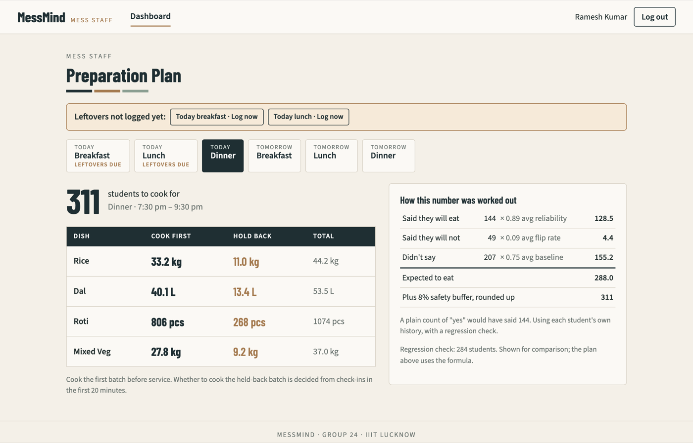
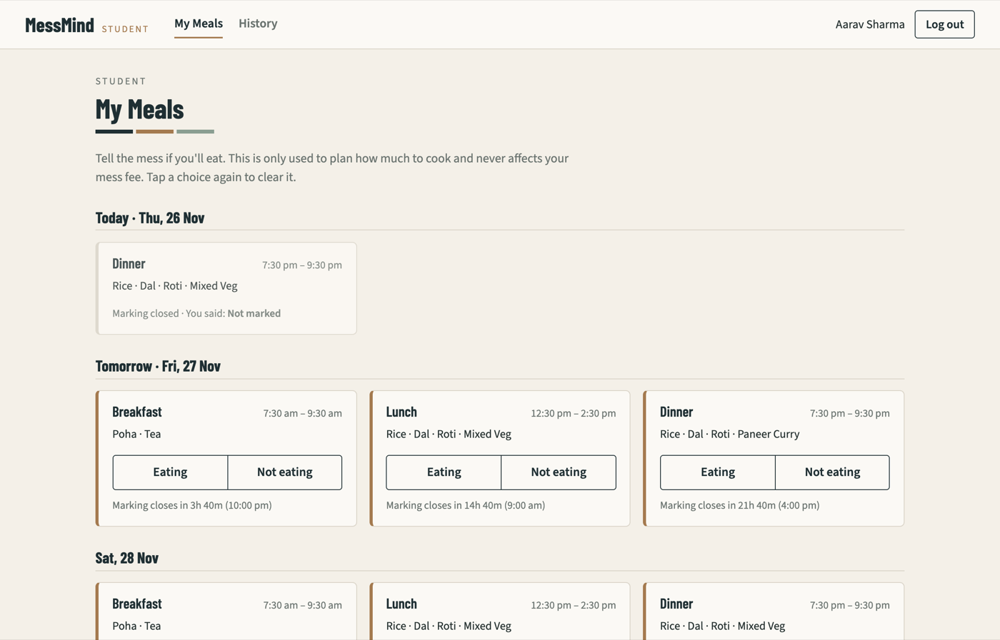
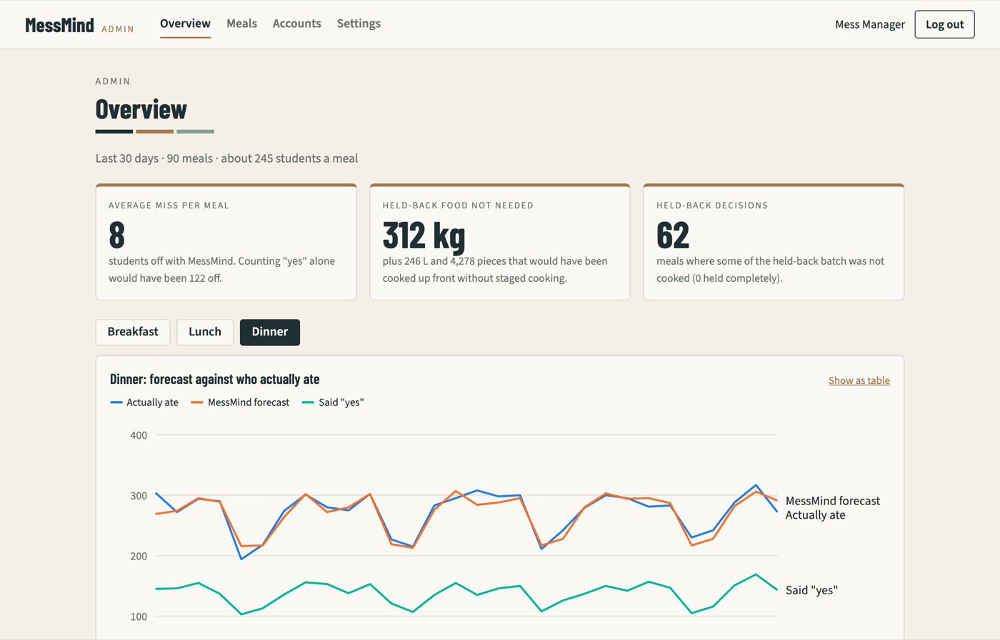

# MessMind

**Smart Hostel Mess Attendance Forecasting and Food Waste Reduction System**

Group 24 · Software Engineering · B.Tech 2nd Year · Indian Institute of Information Technology, Lucknow
Presentation date: 2 December 2026

### [Open the live app →](https://se-messmind.vercel.app)

Sign in with any of these (password `messmind123`):

| Role | Email | What you can do |
| --- | --- | --- |
| Student | `lcb2025101@iiitl.ac.in` | Mark whether you'll eat each meal, see your own history |
| Mess staff | `staff1@iiitl.ac.in` | See how much to cook, log check-ins and leftovers |
| Admin | `admin@iiitl.ac.in` | Forecast accuracy, menus, accounts and settings |

> The API is on a free plan and sleeps after 15 minutes of no use, so the first page load
> can take 30–60 seconds. It is quick after that.

---

## The problem

A mess cook has to decide how much to cook several hours before he knows how many students
will eat. The decision is a guess, and it gets no feedback: nobody measures how wrong
yesterday's guess was, so the same error repeats. Because running short is worse than
wasting food, the guess is also biased high.

MessMind targets that one decision. It collects what students intend to do, corrects those
intentions using each student's own history, recommends a quantity per dish, and then
measures what was actually left over so the next forecast is better.

Over the month of demo data, the system is about **8 students off** per meal on average.
Counting only the students who said "yes" would be **122 off**.

## Screenshots

**Mess staff — how much to cook, and why**



**Student — mark each meal before the cut-off**



**Admin — forecast accuracy and what the system has learned**



## How the forecast works

For each meal, every student counts towards the forecast whether or not they marked:

```
E   = Σ r (said yes)  +  Σ f (said no)  +  Σ b (didn't say)
E'  = E × (1 + β)          safety buffer, rounded up
Q_d = E' × c_d             quantity per dish
B_d = σ × Q_d              first batch, rest held back
```

`r`, `f` and `b` come from each student's own history once they have 15 meals, and from
meal-type and day-of-week averages before that (SRS table 3.1). After every meal the
profiles are updated from who actually came. With 90+ finished meals a small ridge
regression is shown next to the formula; the kitchen plan always uses the formula.

Because the first batch is only part of the total, the rest is held back until check-ins
during service show whether it is needed. Over the demo month that left **298 kg, 246 L and
about 4,100 pieces** of food uncooked that would otherwise have been prepared up front.

After each meal, staff log what is left in each container (Empty / Almost empty / Half left /
Mostly full). The served amount per student is worked out from that, and each dish's
per-student rate moves 20% of the way towards it, so the next quantity plan is closer.

Code: `backend/src/services/` — `estimator.js`, `parameters.js`, `forecast.js`,
`recalibrate.js`, `refiner.js`, `staged.js`, `wasteMath.js`.

## Built with

| Layer | Technology |
| --- | --- |
| Frontend | React 19, Vite, React Router, hand-written SVG charts |
| Backend | Node.js, Express, JSON Web Tokens, bcrypt |
| Database | PostgreSQL |
| Prediction | Deterministic weighted estimator, plus a ridge regression written from scratch |
| Tests | Jest and Supertest — 107 tests |
| Hosting | Vercel (web), Render (API), Neon (database) — all free tiers |

No machine-learning library is used. The regression is about 40 lines of plain JavaScript
(`backend/src/services/ridge.js`) so every step can be explained and checked by hand.

## Documents

- [Software Requirements Specification](docs/SRS.md) (IEEE 830) · [PDF](Group_24/SRS/MessMind_SRS_Group24.pdf)
- [Presentation deck](Group_24/PPT/MessMind_PPT_Group24.pdf)
- [Diagrams](docs/diagrams/) — context, DFD level 0 and 1, use case, class, ER, sequence, activity, state

## Repository layout

```
messmind/
├── docs/
│   ├── SRS.md          # Software Requirements Specification (IEEE 830)
│   ├── diagrams/       # architecture, DFD, use case, class, ER, sequence, activity, state
│   └── screenshots/
├── backend/
│   ├── src/
│   │   ├── routes/     # auth, meal marks, predictions, staff, admin
│   │   ├── services/   # forecasting, staged cooking, waste, recalibration
│   │   └── db/
│   ├── scripts/        # schema setup, demo data, demo helpers
│   └── tests/          # 107 Jest tests
├── frontend/src/
│   ├── pages/          # login, student, staff, admin
│   └── components/
├── database/schema.sql
├── render.yaml         # API deployment blueprint
└── Group_24/           # submission copy for the Drive link
```

## Running locally

Needs Node.js 20+ and PostgreSQL 14+.

```bash
# database
createdb messmind

# backend (http://localhost:4000)
cd backend
cp .env.example .env        # set JWT_SECRET to any random string
npm install
npm run db:reset            # creates tables and a month of demo data
npm run dev

# frontend (http://localhost:5173), in a second terminal
cd frontend
npm install
npm run dev
```

The demo data is generated relative to the day it is loaded, so re-run `npm run db:reset`
before a demo to keep the charts full.

To show the live service panel at any time of day, move the next meal into service:

```bash
cd backend && npm run demo:serve          # service started 18 minutes ago
cd backend && npm run demo:serve -- done  # service just ended, log leftovers
```

## Tests

```bash
createdb messmind_test
cd backend && npm test
```

107 tests across 12 suites. They cover the estimator against the worked example in the SRS
appendix, every stage of the degradation ladder, the marking cut-off boundary, staged-cooking
advice, the waste loop, and that no endpoint exposes one student's record to staff or admin.

## Deployment

| Part | Service | Notes |
| --- | --- | --- |
| Database | [Neon](https://neon.tech) Postgres | free tier, does not expire |
| API | [Render](https://render.com) web service | free; sleeps after 15 min idle |
| Frontend | [Vercel](https://vercel.com) | free hobby plan |

1. **Neon**: create a project, copy the connection string, then load the demo data:
   ```bash
   cd backend
   DATABASE_URL="<neon connection string>" DB_SSL=true npm run db:reset
   ```
2. **Render**: New → Blueprint → this repo. It reads `render.yaml`. Fill in `DATABASE_URL`
   and `CLIENT_URL` (the Vercel URL from step 3; use `http://localhost:5173` until then).
3. **Vercel**: import this repo, set **Root Directory** to `frontend`, add `VITE_API_URL` =
   the Render URL, deploy.
4. Back on Render, set `CLIENT_URL` to the Vercel URL so the browser may call the API.

## How this was built

An incremental process model, five increments, one feature branch and one reviewed pull
request each — matching section 2.8 of the SRS.

| Increment | Covers | Status |
| --- | --- | --- |
| 1. Schema and authentication | FR-1, FR-2, FR-22 | Done |
| 2. Meal marking | FR-3 – FR-7 | Done |
| 3. Prediction engine | FR-8 – FR-13, FR-21 | Done |
| 4. Staff dashboard and staged cooking | FR-14 – FR-18 | Done |
| 5. Waste logging, recalibration and admin | FR-19 – FR-25 | Done |

## Team

| Member | Roll No |
| --- | --- |
| Aary Garge | LCB2025024 |
| Advait Deshpande | LCI2025046 |
| Pruthviraj Mane | LCI2025038 |
| Ranveer Hajari | LCI2025043 |
