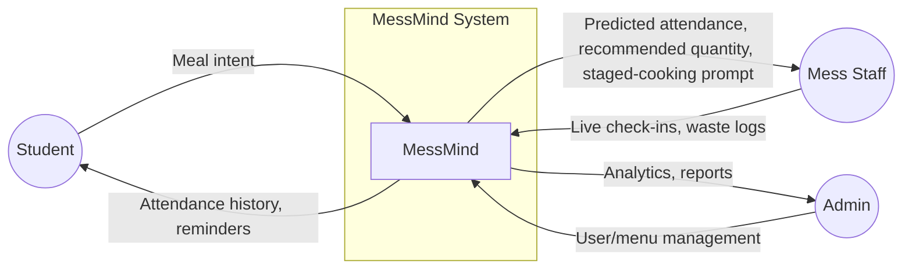
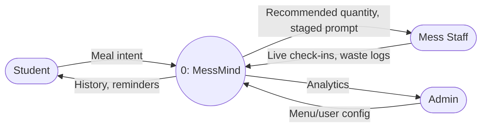
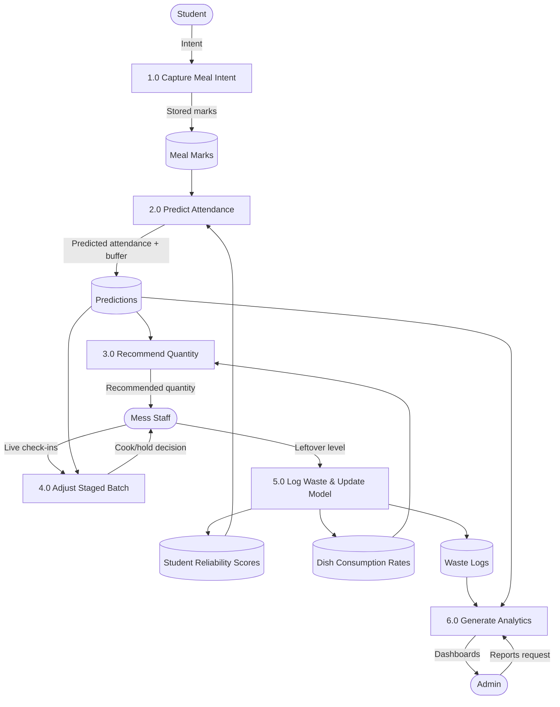
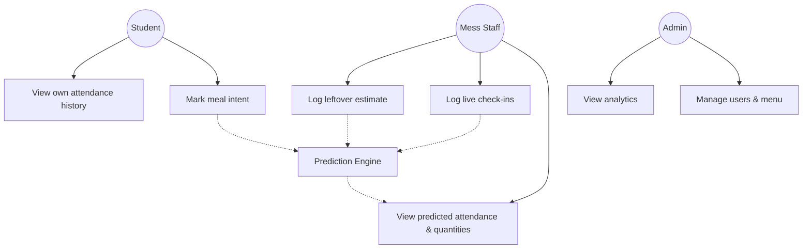
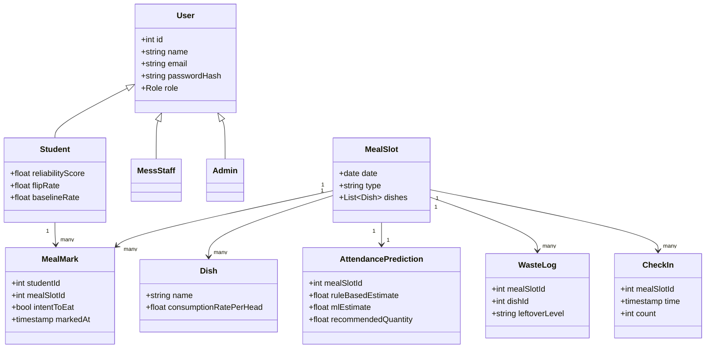
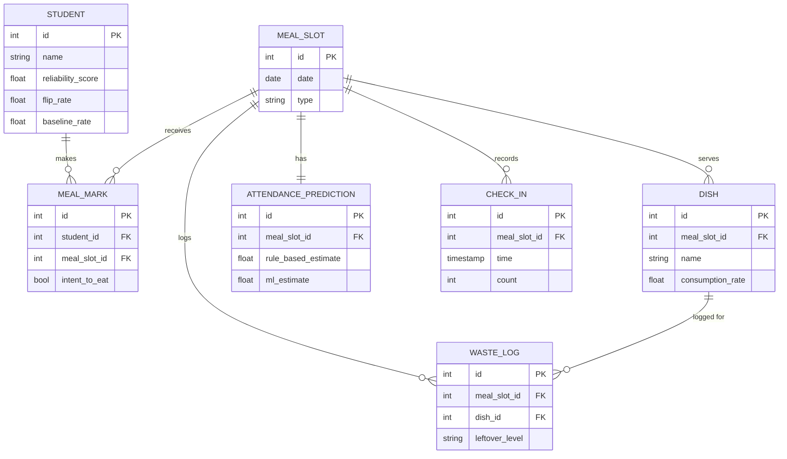
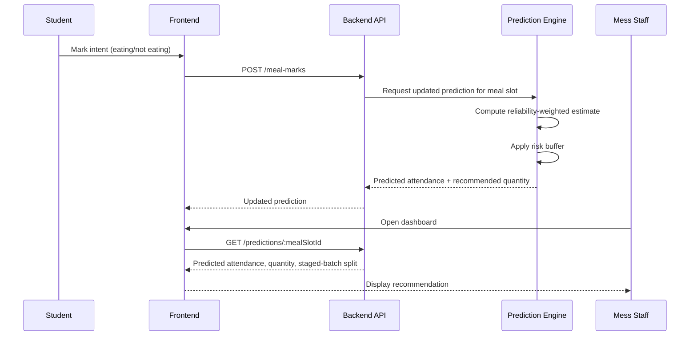
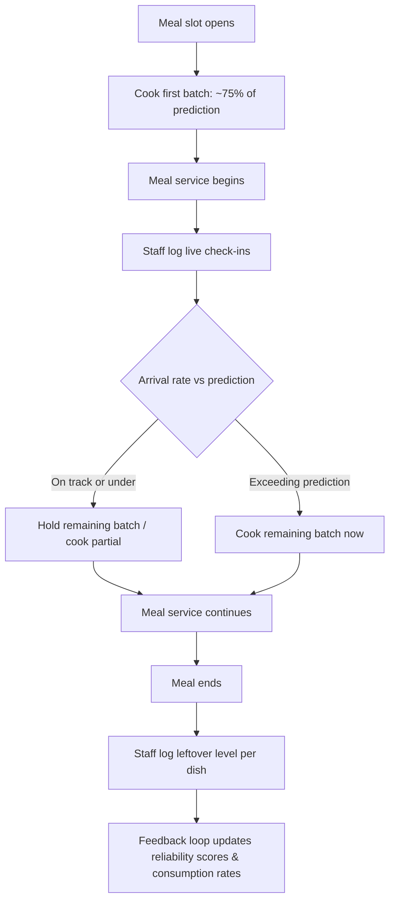
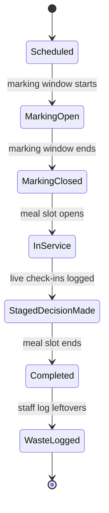

# Software Requirements Specification

**MessMind: Smart Hostel Mess Attendance Forecasting and Food Waste Reduction System**

Group 24 · Software Engineering · IIIT Lucknow · B.Tech 2nd Year
Presentation date: 2 December 2026

| Member | Roll No |
| --- | --- |
| Aary Garge | LCB2025024 |
| Advait Deshpande | LCI2025046 |
| Pruthviraj Mane | LCI2025038 |
| Ranveer Hajari | LCI2025043 |

---

## 1. Introduction

### 1.1 Purpose
This document specifies the requirements for MessMind, a web-based system that forecasts
per-meal hostel mess attendance and recommends preparation quantities, with the goal of
reducing both food wastage and meal shortages.

### 1.2 Scope
Hostel messes currently decide how much food to cook based on the cook's experience and
rough estimates, with no feedback on how accurate that guess was. This causes two
recurring problems at the same mess:

- **Over-preparation** — food is cooked in excess and thrown away.
- **Under-preparation** — food runs out before the mess closes, and the last students in
  line get less or nothing.

MessMind addresses both by (1) collecting per-meal intent from students, (2) correcting
that intent using each student's historical reliability rather than trusting it at face
value, (3) recommending a quantity to the kitchen with a tunable safety buffer, (4)
supporting staged cooking so the kitchen can adjust mid-meal based on live check-ins, and
(5) logging actual leftovers so every meal improves the next prediction.

Out of scope for this project: meal ratings/feedback, menu voting, cost/budget analytics,
complaints, and payments. These are explicitly excluded to keep one core problem in
focus (see professor's presentation guidelines).

### 1.3 Definitions
| Term | Meaning |
| --- | --- |
| Meal slot | One of Breakfast, Lunch, Dinner on a given date |
| Opt-in/Opt-out | A student's declared intent to eat or skip a meal slot |
| Reliability score | A student's historical rate of actually showing up given their declared intent |
| Baseline rate | A student's historical attendance rate when they declare nothing |
| Staged cooking | Preparing a first batch (~75%) before the meal opens, then a decision on
  the remaining batch based on live check-in rate |
| Container-level waste estimate | Leftover logged per dish as Empty / Almost Empty / Half
  Left / Mostly Full, instead of exact weight |

### 1.4 Overview
Section 2 describes the product at a high level, including feasibility and the process
model followed. Section 3 lists functional and non-functional requirements. Section 4
covers external interfaces. Section 5 contains the system models (context diagram, DFD,
use case, class, ER, sequence, activity, state diagrams).

---

## 2. Overall Description

### 2.1 Product Perspective
MessMind is a new, standalone web application. It does not replace existing hostel
infrastructure (mess cards, physical registers) but sits alongside it, consuming
check-in/attendance signals where available and otherwise relying on student-declared
intent and historical patterns.

### 2.2 Product Functions (summary)
- Students mark intent to eat for each upcoming meal slot.
- The system predicts expected attendance per meal slot using a reliability-weighted
  formula (with an optional ML-based refinement layer, see 2.5).
- Mess staff see a recommended preparation quantity per dish, derived from predicted
  attendance and per-dish consumption rates.
- During the first ~15–20 minutes of a meal, live check-ins update the dashboard and
  tell staff whether to cook the held-back (staged) batch.
- Staff log leftover levels per dish after each meal (container-level estimate).
- Logged waste and actual check-in counts feed back into reliability scores and
  consumption rates, improving future predictions.

### 2.3 User Classes
| Role | Description |
| --- | --- |
| Student | Marks per-meal intent, views own meal history |
| Mess Staff | Views predicted attendance, recommended quantities, staged-cooking
  prompts; logs waste after each meal |
| Admin | Manages users, meal slots/menu, views system-wide analytics |

### 2.4 Operating Environment
Responsive web application, accessed via browser on desktop (mess staff counter system)
and mobile (students). No native app required.

### 2.5 Design and Implementation Constraints
- Core prediction logic must be a deterministic, explainable formula (reliability-weighted
  attendance estimate) so the system functions correctly even with no historical data
  (cold start) and even if adoption is low.
- An ML-based refinement (e.g. a regression model trained on day-of-week, menu, holiday/
  exam flags, and prior attendance) is layered on top once sufficient meal history exists.
  It never replaces the rule-based estimate as the sole mechanism — if the ML layer is
  unavailable or under-trained, the system falls back to the rule-based estimate.
- One-week development timeline; built as an incremental skeleton, not a finished product.

### 2.6 Assumptions and Dependencies
- Students are willing to mark intent, but the system must not depend on 100% of students
  doing so (see 2.5, cold-start fallback).
- Mess staff can realistically provide a coarse, container-level waste estimate after each
  meal, not an exact weight.
- A simple check-in mechanism (manual tally or QR scan) is available during the meal
  window for staged-cooking adjustment.

### 2.7 Feasibility Study

| Type | Assessment |
| --- | --- |
| **Technical** | Feasible with standard web technologies (React/Node/PostgreSQL or equivalent) already taught/used in coursework. The prediction engine is a weighted arithmetic formula, not a research-grade model, so it does not require specialised ML infrastructure. An optional lightweight regression layer (scikit-learn) is achievable within the timeline. |
| **Economic** | Low cost. All planned infrastructure (Vercel, Render/Railway, Supabase) has a free tier sufficient for a semester project; no paid services are required. |
| **Operational** | Operationally realistic: students already use phones daily, and mess staff already use a counter system. The only new habit required is a daily container-level estimate from staff, which is low-effort. Adoption risk is mitigated by the cold-start fallback (system works without full participation). |
| **Legal** | No legal constraints. Data collected (meal intent, attendance, aggregate waste) is institutional and non-sensitive; per-student reliability scores are kept internal and never exposed (see NFR-1), avoiding privacy concerns. |
| **Schedule** | Project is scoped to be buildable as a working skeleton by 2 Dec 2026 by a 4-person team, by deliberately excluding side features (ratings, payments, complaints) per the one-core-problem constraint. |

### 2.8 Process Model (SDLC)
The project follows an **Agile/Scrum-style incremental model**, chosen over a strict
Waterfall approach because requirements were refined iteratively through discussion
(e.g. the staged-cooking and waste-logging decisions were only finalised after the
initial brainstorm) and because the one-week timeline demands working increments rather
than a single big-bang delivery.

- The team works in short, informal sprints of 1–2 days, each ending with a usable
  increment (e.g. auth + meal marking → prediction engine → staff dashboard → waste
  logging + feedback loop).
- Scope was deliberately fixed early (Section 1.2) to avoid uncontrolled scope creep
  within such a short schedule — the Agile principle of responding to change is applied
  to *how* features are refined, not to *what* the core problem is.
- Git/GitHub is used as the configuration management tool, with feature branches and
  pull requests per module, satisfying the version-control practice expected by the
  course's laboratory component.

---

## 3. Specific Requirements

### 3.1 Functional Requirements

**Student**
- **FR-1**: A student can mark intent (eating / not eating) for each upcoming meal slot.
- **FR-2**: A student can view their own past attendance and marking history.
- **FR-3**: A student receives a reminder notification before a meal slot closes for
  marking, if they haven't marked yet.

**Prediction Engine**
- **FR-4**: The system computes expected attendance per meal slot as a sum over students
  of: (declared-yes × personal reliability score) + (declared-no × personal flip rate) +
  (not declared × personal baseline rate).
- **FR-5**: Each student's reliability score, flip rate, and baseline rate are derived from
  their own historical attendance and updated after each meal.
- **FR-6**: The predicted attendance is adjusted upward by a configurable safety buffer
  (risk-adjusted estimate) rather than used as a raw mean, since shortage is costlier than
  waste.
- **FR-7**: An optional ML-based model may produce a refined attendance estimate using
  day-of-week, menu, and holiday/exam features; this estimate is shown alongside the
  rule-based estimate and is used only once a minimum history threshold is met.

**Mess Staff**
- **FR-8**: Mess staff can view, per meal slot, the predicted attendance and a recommended
  preparation quantity per dish (derived from predicted attendance × per-dish consumption
  rate).
- **FR-9**: At meal opening, the dashboard recommends a first-batch quantity (~75% of the
  predicted total).
- **FR-10**: During the first portion of the meal window, staff can log live check-in
  counts; the dashboard uses the live arrival rate to recommend whether to prepare the
  remaining batch.
- **FR-11**: After a meal ends, staff log a leftover estimate per dish using a fixed scale
  (Empty / Almost Empty / Half Left / Mostly Full).

**Feedback Loop**
- **FR-12**: Logged leftover estimates and actual check-in counts are used to recompute
  per-dish consumption rates and per-student reliability scores after each meal.

**Admin**
- **FR-13**: Admin can manage student accounts, mess staff accounts, meal slots, and the
  dish list per meal slot.
- **FR-14**: Admin can view aggregate analytics: predicted vs. actual attendance trend,
  waste trend per dish, over time.

**Auth**
- **FR-15**: The system supports three roles (Student, Mess Staff, Admin) with role-based
  access control.

### 3.2 Non-Functional Requirements
- **NFR-1 (Privacy)**: Per-student reliability scores and marking history are internal to
  the prediction model and are never shown to mess staff or admin at an individual level;
  only aggregated predictions are surfaced.
- **NFR-2 (No penalty)**: Marking "not eating" or not marking at all must never be tied to
  any fee, refund, or penalty, to avoid incentivizing students to game their declared
  intent.
- **NFR-3 (Usability)**: Mess staff dashboard must be usable on a shared desktop with
  minimal clicks, since it will be checked repeatedly during a live meal service.
- **NFR-4 (Graceful degradation)**: The system must produce a reasonable prediction from
  day one, before any student-specific history exists, using a flat baseline that narrows
  to segment-level and then per-student estimates as data accumulates.
- **NFR-5 (Performance)**: Dashboard predictions must update within a few seconds of a
  staff action (e.g. logging a live check-in).
- **NFR-6 (Availability)**: The system should be accessible during all meal service
  windows; staged-cooking guidance is only useful if available in real time.

---

## 4. External Interface Requirements

### 4.1 User Interfaces
- Student web view: meal marking, personal history.
- Mess Staff web view: predicted attendance, recommended quantities, staged-cooking
  prompt, waste logging form.
- Admin web view: user/menu management, analytics dashboards.

### 4.2 Software Interfaces
- REST API between frontend and backend.
- Relational database (PostgreSQL) for persistent storage.
- Optional ML service/module invoked by the backend for the refined attendance estimate.

---

## 5. System Models

### 5.1 Context Diagram
Shows MessMind as a single system boundary and its external actors.

### 5.2 Data Flow Diagrams

**Level 0 (Context-level DFD)**

**Level 1 (Process decomposition)**

### 5.3 Use Case Diagram

### 5.4 Class Diagram

### 5.5 Entity-Relationship Diagram

### 5.6 Sequence Diagram — Meal Marking to Quantity Recommendation

### 5.7 Activity Diagram — Staged Cooking

### 5.8 State Diagram — Meal Slot Lifecycle

---

## 6. Future Enhancements
- Richer ML model (e.g. time-series forecasting) once sufficient historical data exists.
- QR-code based check-in instead of manual tally.
- Per-dish popularity trends surfaced to admin analytics.
