# Software Requirements Specification

## MessMind — Smart Hostel Mess Attendance Forecasting and Food Waste Reduction System

| | |
| --- | --- |
| **Course** | Software Engineering · B.Tech (CSE / CSB), 2nd Year |
| **Institution** | Indian Institute of Information Technology, Lucknow |
| **Group number** | 24 |
| **Submitted to** | Dr. Sushil Kumar Tiwari |

**Prepared by**

| Name | Roll number |
| --- | --- |
| Aary Garge | LCB2025024 |
| Advait Deshpande | LCI2025046 |
| Pruthviraj Mane | LCI2025038 |
| Ranveer Hajari | LCI2025043 |

> The formatted submission copy is [`Group_24/SRS/MessMind_SRS_Group24.pdf`](../Group_24/SRS/MessMind_SRS_Group24.pdf).

---

## Table of Contents

1. [Introduction](#1-introduction)
2. [Overall Description](#2-overall-description)
3. [Specific Requirements](#3-specific-requirements)
4. [External Interface Requirements](#4-external-interface-requirements)
5. [System Models](#5-system-models)
6. [Requirements Traceability Matrix](#6-requirements-traceability-matrix)
7. [Future Enhancements](#7-future-enhancements)
- [Appendix A — Worked Example of a Forecast](#appendix-a--worked-example-of-a-forecast)

---

## 1 Introduction

### 1.1 Purpose

This document specifies the requirements for MessMind, a web-based system that forecasts hostel mess attendance for each meal and converts that forecast into a preparation quantity for the kitchen. It defines what the system must do, the constraints it works under, and how each requirement will be checked.

### 1.2 Scope of the Product

A mess cook has to decide how much to cook several hours before he knows how many students will eat. The decision is a guess, and it gets no feedback: nobody measures how wrong yesterday's guess was, so the same error repeats. Because running short is worse than wasting food, the guess is also biased high.

MessMind targets that one decision. It collects what students intend to do, corrects those intentions using each student's own history, recommends a quantity per dish, and then measures what was actually left over so the next forecast is better.

**Table 1.1 — Scope boundary**

| In scope | Out of scope |
| --- | --- |
| Per-meal intent capture from students | Meal ratings and menu voting |
| Attendance forecasting weighted by student reliability | Mess fees, billing and payments |
| Per-dish preparation quantity recommendation | Complaint and grievance handling |
| Staged (two-batch) cooking guidance during service | Cost and procurement analytics |
| Leftover logging after each meal | Inventory and stock management |
| Automatic recalibration of forecast parameters | Nutrition and dietary tracking |

The exclusions are intentional. Each is a separate problem, and including any of them would dilute the single problem this project addresses.

### 1.3 Definitions and Abbreviations

| Term | Meaning |
| --- | --- |
| **Meal slot** | One of Breakfast, Lunch or Dinner on a given date. The unit of forecasting. |
| **Declaration** | A student's statement that they will or will not eat a meal slot. Treated as evidence, not as a commitment. |
| **Marking window** | The period during which declarations can be made or changed. It ends at the marking cut-off. |
| **Reliability score (r)** | How often a student who declared "eating" actually attended. |
| **Flip rate (f)** | How often a student who declared "not eating" attended anyway. |
| **Baseline rate (b)** | A student's attendance rate on slots where they declared nothing. |
| **Safety buffer (β)** | A configurable upward adjustment to the forecast, because a shortage costs more than a surplus. |
| **Staged cooking** | Cooking a first batch before service, then deciding during service whether to cook the rest. |
| **Leftover level** | A four-point estimate of what remains in a container: Empty, Almost empty, Half left, Mostly full. |
| **Cold start** | The state in which the system has too little history to compute per-student parameters. |
| **RBAC** | Role-Based Access Control. |
| **DFD** | Data Flow Diagram. |

### 1.4 References

- **IEEE Std 830-1998** — IEEE Recommended Practice for Software Requirements Specifications. The structure of this document follows this standard.
- **Course handout and presentation guidelines**, Software Engineering, IIIT Lucknow. Source of the single-problem constraint CON-1.
- **Project repository** — source code, this document and the presentation deck, submitted as the Group 24 folder.
- **Deployed system** — https://se-messmind.vercel.app. The web client is hosted on Vercel, the REST API on Render and the database on Neon, all on free tiers.

---

## 2 Overall Description

### 2.1 Product Perspective

MessMind is a new, self-contained web application. It does not replace the mess register or mess-card arrangements already in place; it sits alongside them and uses an attendance signal from them where one exists. Where none exists, it relies on student declarations and its own history.

The application has four layers. Keeping the prediction logic in its own layer is a deliberate choice (CON-4), so the optional machine-learning refinement can be added or removed without touching the API or the interface.

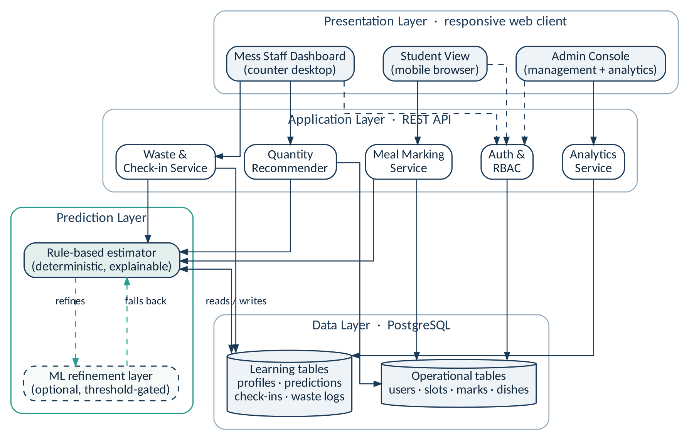

*Figure 2.1 — Layered architecture of the system*

### 2.2 Product Functions

The system performs six functions, which match the six processes in the level 1 data flow diagrams of Section 5.1:

- **Capture intent.** Store each student's declaration for each upcoming meal slot and remind those who have not declared.
- **Predict attendance.** Combine declarations with per-student reliability parameters and apply a safety buffer.
- **Recommend quantity.** Convert attendance into a quantity per dish and split it into a first batch and a held-back batch.
- **Adjust the staged batch.** Compare live check-ins against the forecast during service and advise whether to cook the held-back batch.
- **Log waste and recalibrate.** Record what was left over, derive what was served, and update reliability scores and consumption rates.
- **Generate analytics.** Show aggregate trends in forecast accuracy and wastage to the mess administration.

### 2.3 User Classes and Characteristics

| User class | Characteristics | Frequency of use |
| --- | --- | --- |
| **Student** | Hostel resident using a personal phone. Motivated by convenience, not by any obligation to the system, so participation has to be optional and quick. | Up to 3 times a day, often none |
| **Mess Staff** | Kitchen supervisor or counter attendant at a shared desktop. May have limited familiarity with web applications and little spare time during service. | Several times per meal |
| **Admin** | Mess manager or warden. Configures slots, menus and parameters, and reviews performance. | Weekly |

The Mess Staff characteristics drive NFR-6 directly. A dashboard that takes more than a couple of clicks will not be used during service, and an unused dashboard produces no feedback data.

### 2.4 Operating Environment

The system is a responsive web application. Students use a mobile browser; mess staff use the counter desktop and admin uses an office desktop. Nothing needs to be installed. The server is a Node.js application exposing a REST API over HTTPS, backed by a PostgreSQL database. The prediction module runs in the application layer, with an optional regression refinement as a separate module. Deployment is on managed free-tier hosting, so no on-premise server is required. The working system is deployed and publicly reachable at https://se-messmind.vercel.app.

### 2.5 Design and Implementation Constraints

| ID | Constraint |
| --- | --- |
| CON-1 | The system addresses a single core problem. Features belonging to adjacent problems are excluded, even where they would be easy to build. |
| CON-2 | The core estimator is a deterministic arithmetic formula, not an opaque model, so any recommendation can be explained to the kitchen and reproduced by hand. |
| CON-3 | The system must produce a usable recommendation on its first day, with no historical data. |
| CON-4 | Any machine-learning component is a refinement layer above the deterministic estimator. The system stays fully functional with that layer absent. |
| CON-5 | Leftover measurement must not need weighing equipment. A coarse four-point estimate is the finest granularity the kitchen can realistically supply. |
| CON-6 | Development is limited to one week by a team of four, so the deliverable is a working skeleton rather than a production system. |
| CON-7 | Version control is Git, with feature branches and pull requests per module, as required by the laboratory component. |

### 2.6 Assumptions and Dependencies

| ID | Assumption | If it is false |
| --- | --- | --- |
| ASM-1 | Some students will declare intent, but participation will be partial and inconsistent. | No impact. Undeclared students are forecast from their baseline rate. |
| ASM-2 | Mess staff can give a four-point leftover estimate per dish after each meal. | Consumption rates stop updating; attendance forecasting still works but quantity advice degrades. |
| ASM-3 | A check-in signal, manual or card-based, is available during service. | Staged cooking cannot run; the system falls back to a single-batch recommendation. |
| ASM-4 | Attendance follows stable weekly and menu-linked patterns. | Accuracy falls towards the flat baseline, which is still better than an unaided guess. |
| ASM-5 | Students are not penalised for their declarations, and know it. | Declarations become strategic and reliability scores lose meaning. NFR-2 exists to prevent this. |
| DEP-1 | Free-tier hosting and the PostgreSQL service remain available. | Local deployment for the demonstration. |

### 2.7 Feasibility Study

| Dimension | Assessment |
| --- | --- |
| **Technical** | The stack is conventional and within the team's competence. The estimator is weighted arithmetic over a few database aggregates, not a research problem. |
| **Economic** | All infrastructure is available on free tiers. No licensing, hardware or weighing equipment is needed. |
| **Operational** | Students already carry phones and staff already use a counter desktop. The only new habit is a short leftover entry after each meal. Adoption risk is low because the forecast does not depend on student participation. |
| **Legal** | Data held is institutional and low-sensitivity. Individual attendance is never shown to staff or admin, and declarations carry no financial consequence. |
| **Schedule** | Achievable in one week because scope is fixed by CON-1 and the work splits into four independent modules, one per team member. |

### 2.8 Process Model

The team follows an incremental model rather than a waterfall. The reason is that the requirements themselves changed during the first week: staged cooking and leftover logging were only added after the operational assumptions in Section 2.6 were checked, and a model that fixes everything before construction starts would not have allowed that.

Scope, however, was fixed early. Section 1.2 is treated as closed, so iteration applies to how a feature is built, not to which problem is being solved. Work is split into five short increments: schema and authentication; meal marking; the prediction engine; the staff dashboard and quantity recommendation; and waste logging with recalibration. Git is used throughout, with one feature branch per module and a pull request reviewed by another member before merge.

---

## 3 Specific Requirements

Each requirement is written so that it can be checked individually. Priority is High (needed for the baseline demonstration), Medium (needed for a complete system) or Low (desirable).

### 3.1 Functional Requirements

#### 3.1.1 Access Control and Meal Intent

| ID | Requirement | Priority |
| --- | --- | --- |
| FR-1 | The system shall authenticate every user by institute email address and password before granting access to any module. | High |
| FR-2 | The system shall assign one role to each account — Student, Mess Staff or Admin — and enforce access against that role on the server side. | High |
| FR-3 | A Student shall be able to declare intent to eat or not eat for each upcoming meal slot, and change it any time until the marking cut-off. | High |
| FR-4 | The system shall reject any declaration or amendment made after the marking window has closed. | High |
| FR-5 | A Student shall be able to view their own declarations and attendance for the preceding thirty days. | Medium |
| FR-6 | The system shall remind a Student who has not declared, at a configurable interval before the cut-off. | Medium |
| FR-7 | The system shall treat a declaration as an observation only. No fee, refund, penalty or entitlement shall be derived from it. | High |

#### 3.1.2 Attendance Forecasting

| ID | Requirement | Priority |
| --- | --- | --- |
| FR-8 | The system shall compute expected attendance for each meal slot as the sum of three weighted groups: students who declared they would eat, weighted by reliability score; students who declared they would not, weighted by flip rate; and students who declared nothing, weighted by baseline rate. | High |
| FR-9 | The system shall maintain a reliability score, flip rate and baseline rate for every Student, derived only from that student's own history. | High |
| FR-10 | The system shall recompute the affected student parameters after each completed meal slot. | High |
| FR-11 | The system shall produce a usable forecast when no per-student history exists, using institute-level and then segment-level baselines as given in Section 3.2.2. | High |
| FR-12 | The system shall adjust expected attendance upward by a configurable safety buffer before issuing any recommendation. | High |
| FR-13 | The system may compute a refined forecast from a regression model. Where computed, it shall be shown alongside the deterministic forecast, and the deterministic forecast shall be used whenever the model is unavailable or under-trained. | Low |

#### 3.1.3 Quantity Recommendation and Staged Cooking

| ID | Requirement | Priority |
| --- | --- | --- |
| FR-14 | The system shall convert expected attendance into a recommended quantity for each dish, using that dish's current per-head consumption rate. | High |
| FR-15 | The system shall split the recommended quantity into a first batch and a held-back batch, defaulting to 75 and 25 per cent. | High |
| FR-16 | Mess Staff shall be able to record cumulative check-in counts during the service window. | High |
| FR-17 | The system shall compare the observed arrival rate with the forecast and recommend either cooking or holding the held-back batch. | High |
| FR-18 | The system shall show staff-facing quantities in kitchen units — kilograms, litres or batch counts — not as a headcount. | Medium |

#### 3.1.4 Waste Logging, Recalibration and Administration

| ID | Requirement | Priority |
| --- | --- | --- |
| FR-19 | Mess Staff shall be able to record a leftover level for each dish after service closes, on the scale Empty, Almost empty, Half left, Mostly full. | High |
| FR-20 | The system shall derive the served quantity for each dish from the quantity prepared and the leftover level, and recompute that dish's per-head consumption rate. | High |
| FR-21 | The system shall record the forecast error for every completed meal slot and retain it for analysis. | High |
| FR-22 | Admin shall be able to create, amend and deactivate Student and Mess Staff accounts. | Medium |
| FR-23 | Admin shall be able to define meal slots, their marking and service windows, and the dish list for each slot. | High |
| FR-24 | Admin shall be able to configure the safety buffer and the first-batch split. | Medium |
| FR-25 | The system shall present all staff-facing and admin-facing figures as aggregates. No screen shall show an identifiable student's declaration or attendance. | High |

### 3.2 The Prediction Model

This section explains the model behind FR-8 to FR-13. It is stated in full because it is what separates this system from a meal-booking application, and because CON-2 requires that any recommendation be reproducible by hand.

#### 3.2.1 Why declarations are not counted directly

The obvious design is to count the students who said they would eat. That fails for three reasons: students forget to declare, students declare and then change plans, and students who declared they would not eat sometimes turn up. A raw count treats every student as either present or absent, when in fact each of these three groups has a different and measurable attendance probability.

MessMind therefore treats a declaration as evidence to be weighted rather than a fact to be counted. Every student carries three parameters learned from their own history, and every student contributes to the forecast whether or not they declared anything. One consequence is worth stating: the system still works if no student ever uses the marking feature. Participation improves the forecast, it is not a precondition for it.

#### 3.2.2 The estimator and cold start

For a meal slot, let *Y* be the students who declared they would eat, *N* those who declared they would not, and *U* those who declared nothing. Then:

```
E   = Σ(i∈Y) rᵢ  +  Σ(i∈N) fᵢ  +  Σ(i∈U) bᵢ
E'  = E × (1 + β)          risk-adjusted attendance
Q_d = E' × c_d             quantity to prepare for dish d
B_d = σ × Q_d              first batch for dish d
```

The buffer β is not a safety margin bolted on at the end. The cost of error is asymmetric: a shortage turns students away, while a surplus wastes a recoverable amount of food. The buffer shifts the recommendation to a risk-adjusted level instead of a central estimate, and it is a configurable parameter (FR-24) so the mess decides where on that trade-off it wants to sit.

CON-3 requires a usable recommendation on day one, so the estimator degrades through four stages, each using a coarser parameter where a finer one is not yet supported by data.

**Table 3.1 — Degradation ladder for the estimator**

| Stage | Data available | Parameters used | Accuracy |
| --- | --- | --- | --- |
| **Stage 0** | None | Institute-wide flat attendance rate for all students | Low |
| **Stage 1** | 7 or more completed slots | Segment baselines by meal type and day of week | Moderate |
| **Stage 2** | 15 or more observations per student | Per-student reliability, flip and baseline rates | Good |
| **Stage 3** | 90 or more completed slots | Stage 2 plus optional regression refinement | Best available |

A student without enough personal history inherits the segment parameter for their stage, so the system never has to choose between a confident claim it cannot support and no answer at all.

### 3.3 Non-Functional Requirements

| ID | Requirement | How it is checked |
| --- | --- | --- |
| NFR-1 | Per-student parameters and declaration history shall stay internal to the model and never be shown at individual level to Mess Staff or Admin. | No endpoint returns an identifiable student's record to a staff or admin credential. |
| NFR-2 | No financial or disciplinary consequence shall attach to declaring, or not declaring, intent. | No module reads the declaration table for billing, refund or penalty. |
| NFR-3 | The system shall return a usable forecast under cold-start conditions. | A forecast is produced with the parameter table empty. |
| NFR-4 | Every recommendation shall show the three group contributions and the buffer that produced it. | The dashboard shows the breakdown and the figure can be reproduced by hand. |
| NFR-5 | Dashboard figures shall reflect a new check-in within three seconds under expected load. | Measured with 500 seeded students. |
| NFR-6 | Mess Staff shall be able to record a check-in in no more than two clicks from the dashboard. | Timed walkthrough. |
| NFR-7 | The student interface shall be usable without horizontal scrolling at a 360 px viewport. | Browser device emulation. |
| NFR-8 | Passwords shall be stored salted and hashed, and authorisation enforced server-side on every request. | No endpoint relies on client-side role checks. |
| NFR-9 | Forecasting logic shall sit behind one service interface so the refinement layer can be replaced without touching the API or interface layers. | Substituting the estimator requires no edit outside the prediction module. |

---

## 4 External Interface Requirements

**User interfaces.** The student view lists upcoming meal slots with a two-state control per slot and a visible cut-off time, plus a personal history view. The staff dashboard is a single screen for the current slot showing expected attendance with its group breakdown, per-dish quantity in kitchen units, the first-batch figure, a check-in entry control and the cook-or-hold prompt. The waste logging form has one row per dish with four options. The admin console covers accounts, meal slots, parameters and aggregate analytics.

**Hardware interfaces.** No dedicated hardware is needed. Where the hostel already has a mess-card reader, the system can use its events as the check-in signal; otherwise staff enter a manual tally. No weighing equipment is used (CON-5).

**Software interfaces.** The client talks to the server as JSON over a REST API with bearer-token authentication. The server uses PostgreSQL over a pooled connection, and calls the prediction module through a single internal service interface. Reminders are delivered through a browser or email notification provider.

**Communication interfaces.** All traffic uses HTTPS. The student interface confirms a declaration only once the server acknowledges it, so a dropped connection leaves the declaration unrecorded rather than silently lost — a case the forecast already handles, since undeclared students are predicted from their baseline rate.

---

## 5 System Models

The models below are different views of the same system. Section 6 maps each requirement to the models that realise it.

### 5.1 Data Flow Diagrams

The level 0 diagram fixes the system boundary. Three external entities interact with MessMind and no other external system is needed.

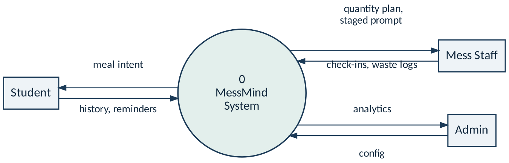

*Figure 5.1 — Data flow diagram, level 0 (context)*

The level 1 decomposition is shown in two halves so it stays readable. The first covers the path from a declaration to the quantity plan that reaches the kitchen.

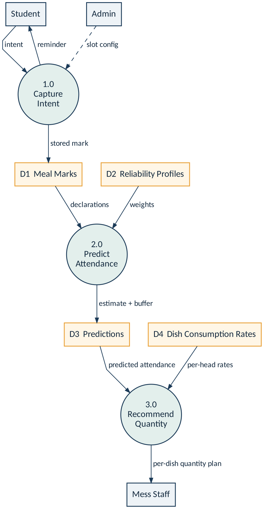

*Figure 5.2 — Level 1, forecasting path (processes 1.0 to 3.0)*

The second covers what happens during and after service: the staged-batch decision, the recalibration that closes the loop, and the aggregation feeding the analytics.

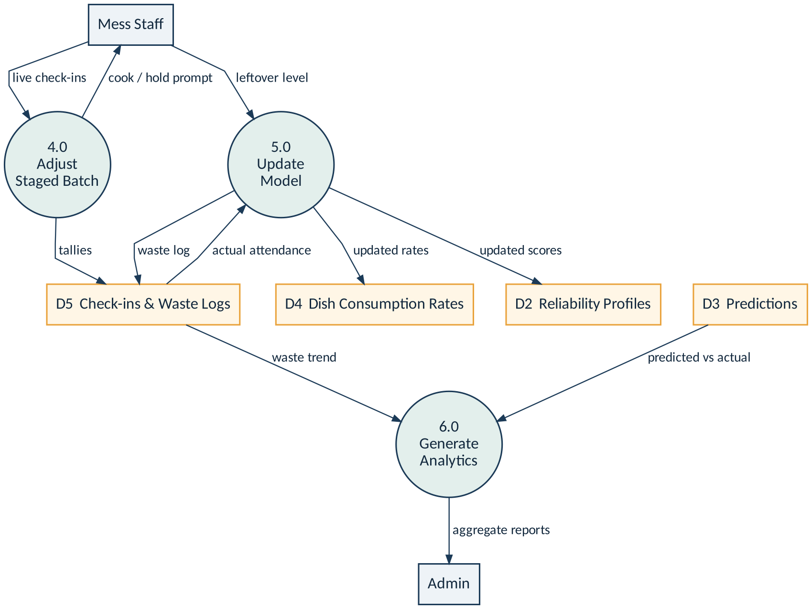

*Figure 5.3 — Level 1, service and feedback path (processes 4.0 to 6.0)*

### 5.2 Use Case Diagram

The Prediction Engine appears as a secondary actor. Modelling it that way makes it explicit that forecasting and recalibration are triggered by the system itself, not by any human user.

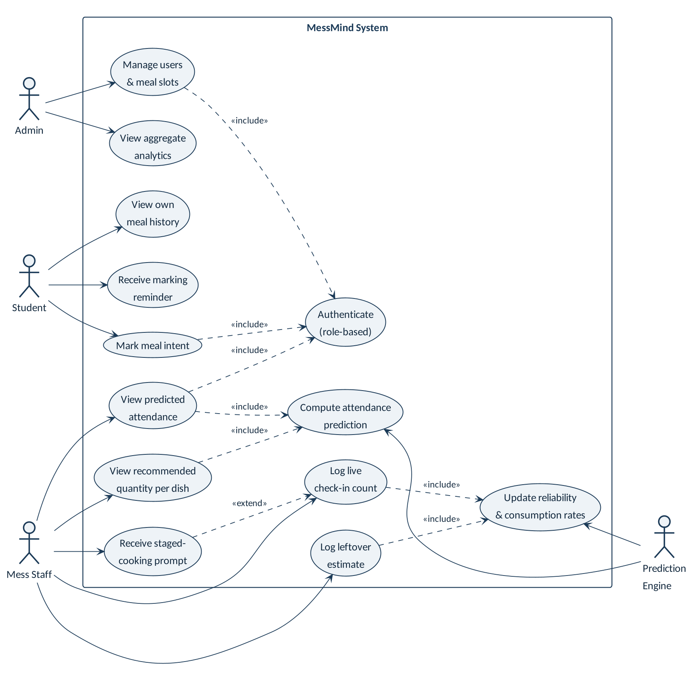

*Figure 5.4 — Use case diagram*

### 5.3 Class Diagram

The class model separates the three user types from the domain entities and keeps forecasting behaviour in a `PredictionEngine` service class. `ReliabilityProfile` is a class of its own rather than attributes on `Student`, because it is updated by recalibration (FR-10), not by account management (FR-22).

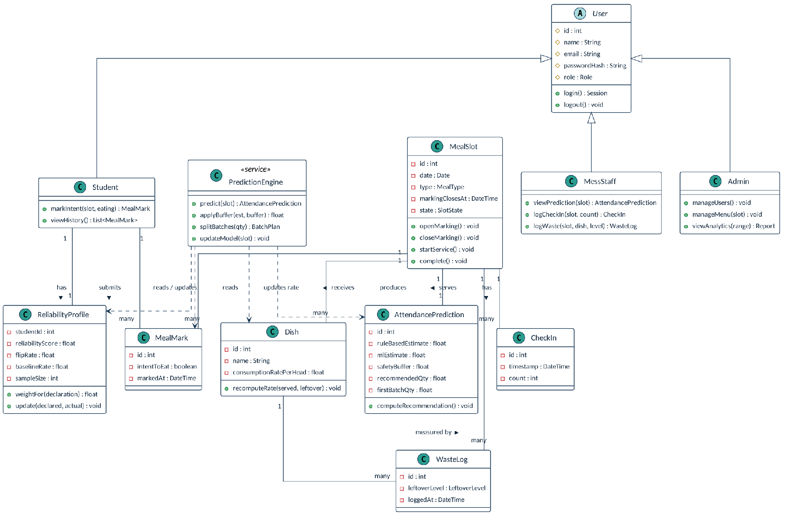

*Figure 5.5 — Class diagram*

### 5.4 Entity-Relationship Diagram

The logical data model realises the class model in relational form. Reliability parameters sit in a separate table from the user record so recalibration writes do not contend with account updates, and so the privacy boundary of NFR-1 can be enforced at the query layer.

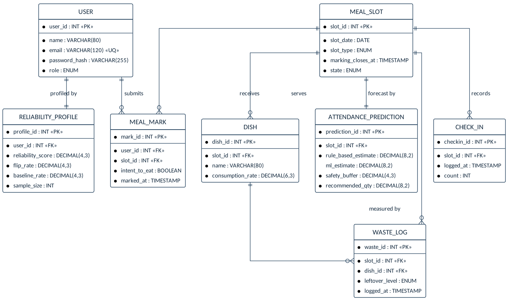

*Figure 5.6 — Entity-relationship diagram*

### 5.5 Sequence Diagram

This sequence traces a single declaration through to the figure the kitchen acts on, showing where the reliability weighting and the safety buffer are applied.

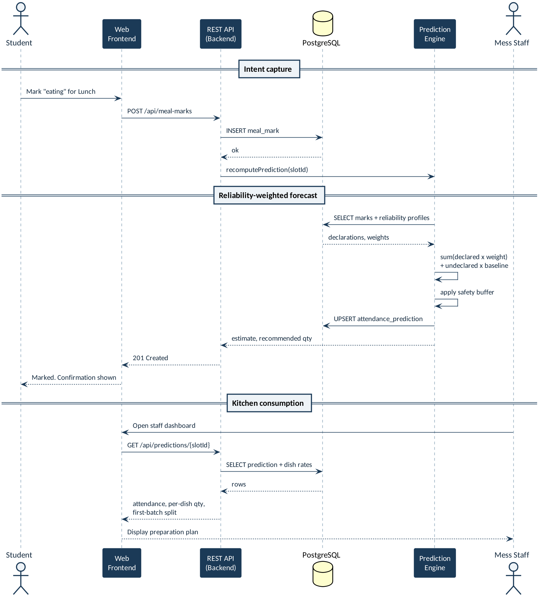

*Figure 5.7 — Meal declaration to quantity recommendation*

### 5.6 Activity Diagram

The service activity contains the only loop in the system that runs against the clock, and the decision that separates a dashboard from a control system: whether to commit the held-back batch.

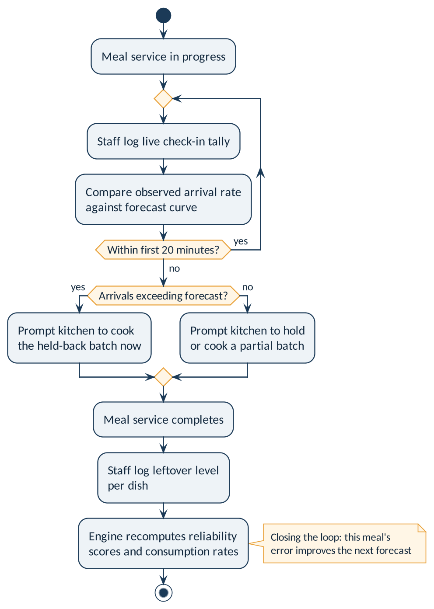

*Figure 5.8 — Service window and feedback loop*

### 5.7 State Transition Diagram

A meal slot moves through a fixed lifecycle. Modelling it as a state machine lets the system reject operations that are invalid for the current state, most importantly a change to a declaration after the marking window has closed (FR-4).

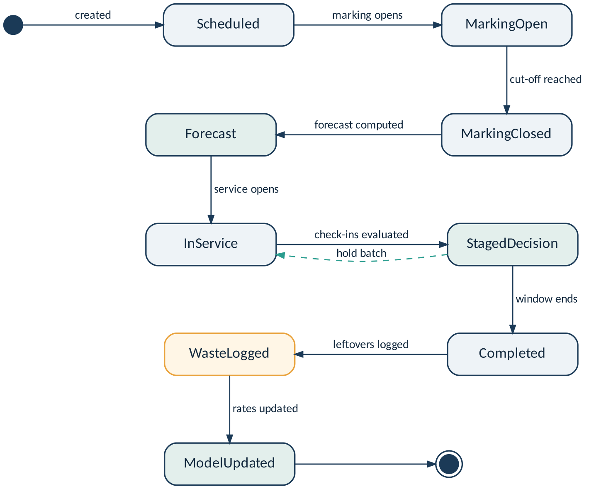

*Figure 5.9 — Meal slot lifecycle*

### 5.8 The Feedback Loop

The models above describe structure and sequence. This one describes the property that gives the system its value over time: the forecast is a loop whose error is measured and fed back, not a one-way prediction.

A canteen ordering system records what was ordered. MessMind records what was prepared, what was served and what remained, then uses the difference to correct the parameters that produced the recommendation. Every completed meal makes the next forecast better, so accuracy depends on how long the system has been running rather than on how carefully it was configured.

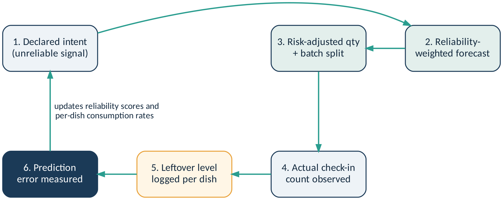

*Figure 5.10 — The closed loop: declaration, forecast, measurement, correction*

---

## 6 Requirements Traceability Matrix

The matrix traces each group of requirements to the model that realises it and the method by which it will be checked. Three items deserve a note. Forecast correctness is checked by computing a forecast by hand from seed data and asserting the system reproduces it exactly, which separates an implementation defect from ordinary forecast error. Recalibration is checked by running a simulated meal cycle with a known discrepancy and confirming the parameters move in the right direction. NFR-1 and FR-25 are negative requirements, so they are checked by enumerating every endpoint under a staff credential.

| Requirements | Design element | Model reference | Verification method |
| --- | --- | --- | --- |
| FR-1, FR-2 | Auth and RBAC service | Fig. 2.1, Fig. 5.5 | Integration test per role |
| FR-3 – FR-7 | Meal marking service; MealMark | Fig. 5.4, Fig. 5.7 | Functional test; boundary test at cut-off |
| FR-8 – FR-10 | PredictionEngine; ReliabilityProfile | §3.2.2, Fig. 5.5 | Unit test against hand-computed forecast |
| FR-11, FR-13 | Degradation ladder; fallback path | Table 3.1 | Test with empty parameter table |
| FR-12 | Buffer applied in recommendation | §3.2.2 | Unit test across buffer values |
| FR-14, FR-15, FR-18 | Quantity recommender | Fig. 5.3, Fig. 5.7 | Functional test; staff walkthrough |
| FR-16, FR-17 | Staged batch evaluator | Fig. 5.8 | Scenario test: arrivals above and below forecast |
| FR-19 – FR-21 | Waste service; recalibration | Fig. 5.3, Fig. 5.10 | End-to-end cycle test on seed data |
| FR-22 – FR-24 | Admin console; analytics | Fig. 5.3 | Functional test per screen |
| FR-25, NFR-1 | Aggregation at the query layer | Fig. 5.6 | Endpoint audit under staff credential |
| NFR-2, ASM-5 | Declaration isolated from billing | §2.6 | Code review; schema inspection |
| NFR-4 | Stored forecast inputs; breakdown panel | §3.2.2 | Re-derivation of a stored forecast |
| NFR-5 – NFR-7 | Dashboard design | §4 | Timed walkthrough; viewport test |
| NFR-9 | Single prediction service interface | Fig. 2.1 | Substitution test |

---

## 7 Future Enhancements

The following are outside the scope fixed in Section 1.2, and are recorded so the boundary stays deliberate.

- **Time-series forecasting model** once enough history exists, to capture seasonality the current feature set treats as independent effects.
- **Automated check-in** by card or QR, replacing the manual tally of FR-16 and improving the arrival-rate signal.
- **Per-dish popularity signal,** since menu composition clearly shifts attendance and a popularity term would sharpen the estimator.
- **Weight-based leftover capture,** replacing the four-point scale of CON-5 with a continuous measure.
- **Multi-mess deployment,** so parameters can be compared across hostels rather than scoped to one mess.

---

## Appendix A — Worked Example of a Forecast

This shows the estimator of Section 3.2.2 on a dinner slot in a hostel of 400 students, with the system at Stage 2. The figures are illustrative.

**Table A.1 — Group contributions**

| Group | Students | Mean weight | Contribution |
| --- | --- | --- | --- |
| Declared they would eat (Y), weighted by reliability score | 180 | 0.94 | 169.2 |
| Declared they would not eat (N), weighted by flip rate | 60 | 0.08 | 4.8 |
| Declared nothing (U), weighted by baseline rate | 160 | 0.52 | 83.2 |
| **Expected attendance E** | **400** | — | **257.2** |

A naive count of declarations would have given 180. The estimate is 257, because the 160 undeclared students are not absent, only unobserved, and their own history says roughly half of them will come.

**Table A.2 — From attendance to the kitchen**

| Step | Computation | Result |
| --- | --- | --- |
| Apply safety buffer β = 0.08 | 257.2 × 1.08 | 277.8 → 278 students |
| Rice, consumption rate 0.145 kg per head | 278 × 0.145 | 40.3 kg |
| Dal, consumption rate 0.210 L per head | 278 × 0.210 | 58.4 L |
| **First batch of rice, split σ = 0.75** | **40.3 × 0.75** | **30.2 kg** |
| **Held back pending check-ins** | **40.3 − 30.2** | **10.1 kg** |

Twenty minutes into service, 196 students have checked in against a forecast of 170 at that point. Arrivals are running ahead, so the system prompts the kitchen to cook the held-back 10.1 kg. Had arrivals tracked below the forecast, that quantity would never have been cooked, and that is where the waste reduction actually comes from.

**After the meal.** Recorded attendance is 271 against a forecast of 278, an error of +2.6 per cent. Leftovers are logged as Almost empty for rice and Half left for dal. The system derives the served quantities, revises dal's consumption rate downward, and adjusts the reliability scores of every student whose declaration did not match their attendance. The next dinner forecast uses the corrected parameters.
